# PsychologicalConsultation
心理咨询管理系统 
亮点：WebSocket实时沟通、基于用户的协同过滤、 ECharts多维分析、 预约业务流程、预约校验与定时处理；
角色：学生、心理咨询师、管理员；

# 心理咨询管理系统（心理咨询室）

> B/S 前后端分离 · 用户网页前台 + 咨询师工作台 + 管理后台 · 管理员 / 咨询师 / 普通用户三角色
>
> Spring Boot 3 + Vue 2 + MyBatis-Plus + WebSocket + ECharts + AiEditor 富文本编辑器

一套心理咨询预约与交流系统：用户在「心理咨询室」浏览咨询师、按日期挑时段预约、线上取号、完成后评价；预约前后还能和咨询师在线聊。咨询师在自己的工作台配排班与名额、看预约记录、进行接诊。管理员维护咨询师、排班、话题和科普文章，并从预约、时段、话题几个维度看数据。前台是暖米色插画风，后台是白色表格加砖红按钮。

---

## 一、技术栈

| 层次 | 选型 |
| :--- | :--- |
| 架构 | B/S、MVC、前后端分离、用户网页前台 + 咨询师工作台 + 管理后台、管理员 / 心理咨询师 / 普通用户三角色 |
| 运行环境 | Windows |
| 开发工具 | IDEA、JDK 17、Maven、MySQL、Node.js |
| 后端 | Java、Spring Boot 3、Spring MVC、MyBatis-Plus、MySQL、JWT、WebSocket、Spring 定时任务 |
| 前端 | Vue 2、Vue CLI、Element UI、Vue Router、Vuex、Axios、ECharts、AiEditor 富文本编辑器 |

## 二、角色与功能范围

| 角色 | 主要使用范围 |
| :--- | :--- |
| 普通用户 | 注册登录、找回密码、改资料改密码；浏览咨询师介绍、专业特长、服务评价与统计；收藏咨询师；按日期查看排班、选时段提交预约；我的预约、取消预约、线上取号、就诊评价；在线联系咨询师、查看聊天记录；心理科普文章浏览；话题搜索、分类浏览、发布话题、看作者主页、评论、评论点赞、话题收藏；我的话题、话题收藏 |
| 心理咨询师 | 维护个人资料；配置咨询时段与预约名额；查看预约记录、取消预约、完成就诊（进行接诊）；在线接收用户咨询、聊天沟通 |
| 管理员 | 数据看板（预约总数、今日预约、社区话题、话题浏览、近 7 天预约趋势、预约状态分布）；用户管理、咨询师资料管理、排班管理、预约记录管理；话题分类管理、话题内容管理、话题审核与推荐设置；心理健康资讯分类与内容维护；预约综合分析、历史与未来 15 天预约统计、咨询师服务人次统计；话题浏览统计、分类分布、发布趋势、用户活跃度与内容互动分析 |

## 三、功能亮点

- **WebSocket 实时沟通**：用户与咨询师各自有一个会话窗口，消息实时推送，支持历史记录查询，预约前后都能接着聊。
- **基于用户的协同过滤**：用话题浏览行为构建用户兴趣数据，通过余弦相似度算出用户之间的关联，为登录用户筛出相关话题；没有相近用户时退回到近期话题。
- **ECharts 多维分析**：管理端看预约状态分布、时段分布、近 30 天预约趋势、话题浏览与分类分布；咨询师详情里另有就诊趋势、星期分布、时段与评分统计。
- **预约业务流程**：咨询师排班、名额配置、时段预约、线上取号、完成就诊、服务评价串成一条线，每一步在界面上都有对应页面。
- **预约校验与定时处理**：排班页展示剩余名额，提交时检查重复预约和时间冲突；定时任务把超过结束时间还停在待就诊的预约标记为过期作废。

---

## 四、界面展示

> 说明：源文档首图为三角色登录页，未提供独立的系统总览图，故「登录入口」单独成节，首图不充当总览横幅。全部截图均为桌面网页：用户端多为 1.3–2.0 比例，咨询师端与管理端为 2.16 比例宽屏，一律全宽单图排布以保持文字清晰。

### 4.1 登录入口

左侧是一幅咨询室插画——沙发、书架、绿植，配「给自己一点时间，让心事慢慢被听见。」右侧登录卡标着「欢迎回来 / 登录心理咨询室」，顶部三枚身份切换按钮（用户 / 咨询师 / 管理员），下面依次是账号、密码、验证码，底部「还没有账号？创建账号」与「安心交流，尊重隐私」提示。

三个角色共用这一个入口，切换身份登录后进入各自的工作台。

### 4.2 普通用户端

#### 首页

导航依次是首页、咨询师、咨询服务、心理科普、社区交流、我的预约、我的咨询、收藏咨询师、我的话题、话题收藏、个人中心。首屏左侧一段文案加两枚按钮（预约一次咨询 / 先了解咨询师），右侧是暖色咨询室图；下面三个引导块——找到适合的咨询师、选择方便的时间、第一次来咨询？。

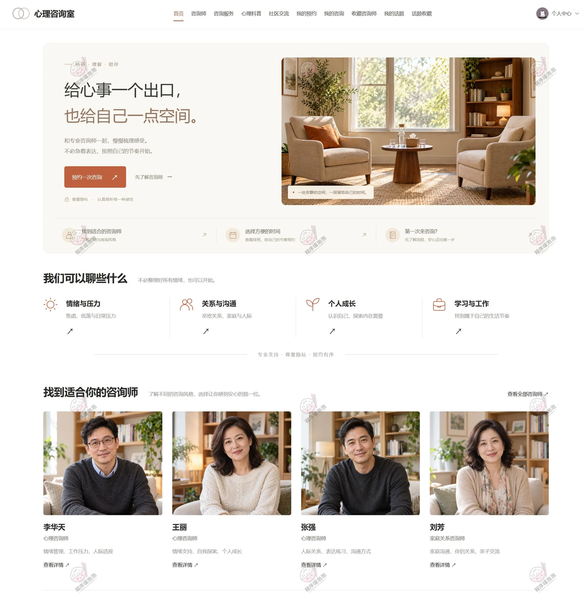

「我们可以聊些什么」把咨询方向分成四类：情绪与压力、关系与沟通、个人成长、学习与工作，每类给一句场景说明。「找到适合你的咨询师」推荐四位：李华天（情绪管理、工作压力、人际关系）、王丽（情绪支持、自我探索、个人成长）、张强（人际关系、表达练习、沟通方式）、刘芳（家庭关系咨询师，家庭沟通、伴侣关系、亲子交流）。

#### 咨询师列表

搜索框支持按姓名或擅长方向查；下面两行筛选——咨询方向（全部 / 情绪与压力 / 人际关系 / 个人成长 / 家庭与亲密关系 / 学习与工作）、咨询师性别（不限 / 男 / 女），右上角排序可切「默认排序 / 可预约优先」。

卡片按三列排，每张给照片、姓名、职称、三个擅长标签、一句介绍，底部「查看详情 / 预约咨询」两个入口。

#### 咨询服务（预约）

页面顶部标着三步：01 选择日期与咨询师、02 选择时段、03 确认预约。日期条按周排开 10 月 24 日至 10 月 30 日，每格写星期与状态——10 月 24 日是「未排班」，其余「可预约」，选中的一天显示橙色圆点。下面咨询师卡片直接带上当天状态与剩余名额。

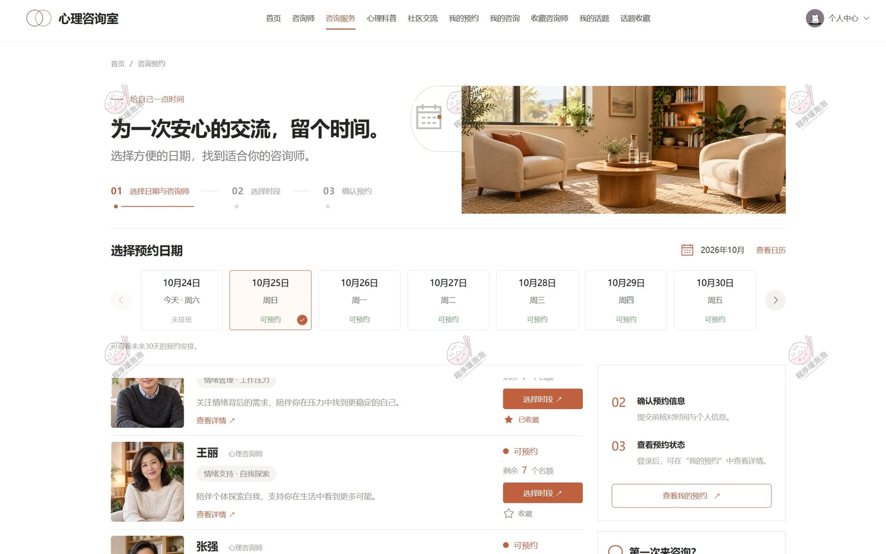

王丽的卡片写着「可预约 · 剩余 7 个名额」，旁边一枚「选择时段」按钮；已收藏的咨询师（李华天）标着红心「已收藏」。右侧栏把三步流程再写一遍，并给「查看我的预约」入口。

#### 我的预约

顶部四个状态标签：全部预约、待咨询、已完成、已取消，右侧可按日期区间查。每条预约把时间段放在标题位（2026 年 10 月 16 日 · 周五 09:00 — 10:00），右上角标状态「已完成」；下面左列咨询师头像与姓名、职称、擅长方向，中间就诊号与联系电话，右列支付方式与支付金额。

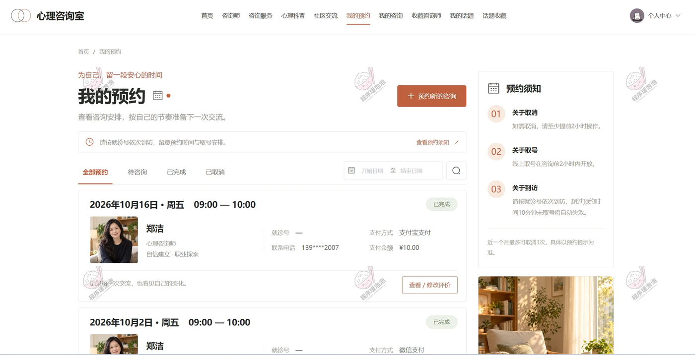

这条是郑洁（心理咨询师，自信建立 · 职业探索），支付宝支付 ¥10.00，联系电话 139****2007，就诊号一栏是「—」——没取号的预约就留空。第二条是 10 月 2 日同时间段的预约，微信支付。右侧「预约须知」写了三条规则：取消需至少提前 2 小时、线上取号在咨询前 2 小时内开放、超过预约时间 10 分钟未取号自动失效；另有「近一个月最多可取消 3 次」的限制。

#### 我的咨询（在线沟通）

左侧「最近会话」有两个会话（郑洁、李华天），带最后一条消息预览，中间是对话区，顶部显示对方姓名与「心理咨询资料」链接，并挂着一条提示「保护个人隐私，妥善保管聊天信息。」空白会话页写着一句引导「从你想说的话开始，按照自己的节奏慢慢来。」

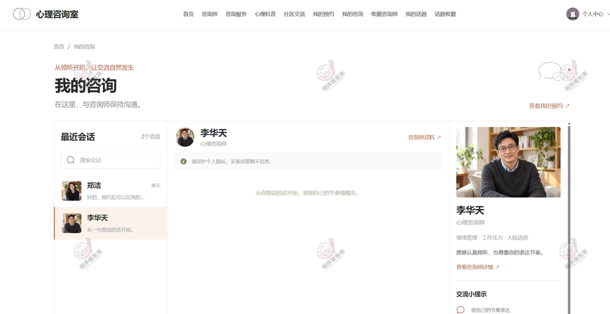

右侧是咨询师名片：照片、姓名、职称、三个擅长方向、一句自我介绍，下面是「交流小提示」。

#### 心理科普

搜索框下面一排分类：全部文章、情绪管理、压力应对、人际关系、个人成长、咨询指南。「精选阅读」是通栏大卡，《把情绪写下来：给自己的五分钟练习》，标 2026.10.02、1 分钟阅读。「慢慢读，也慢慢了解自己」按最新发布 / 热门阅读排序，三列卡片带封面、分类、标题、摘要、日期与阅读数。

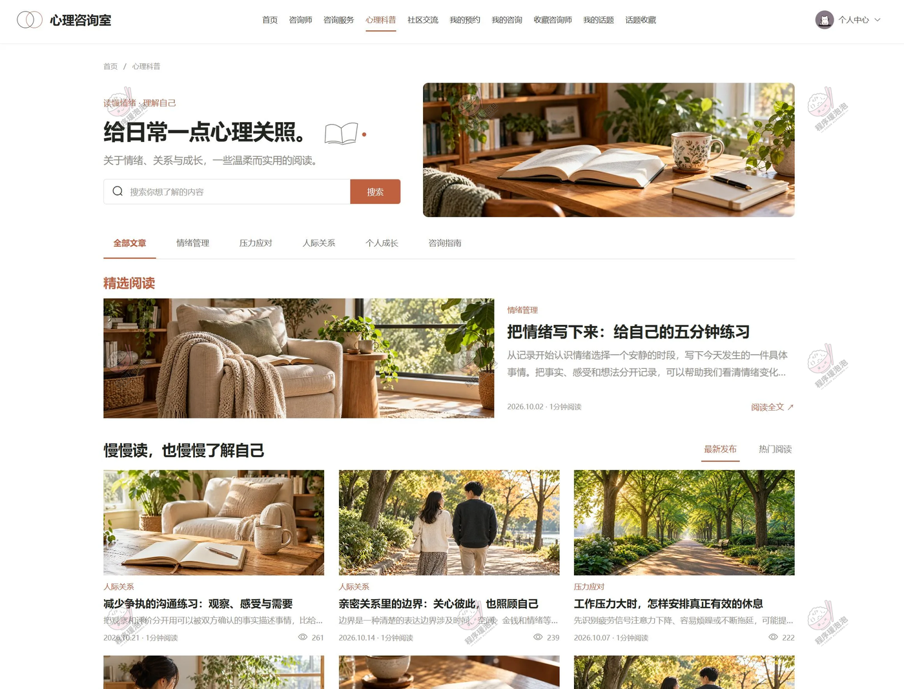

三张卡的阅读数分别是 261、239、222——《减少争执的沟通练习：观察、感受与需要》（人际关系）、《亲密关系里的边界：关心彼此，也照顾自己》（人际关系）、《工作压力大时，怎样安排真正有效的休息》（压力应对）。这三篇正是后台科普文章列表里的三条，后台显示 260 / 239 / 222，多出来的一次就是本次访问。

#### 社区交流

顶部四个排序标签：推荐、近期、热门、优选，下面再按话题分类筛（全部话题 / 情绪与压力 / 人际关系 / 个人成长 / 学习与工作）。帖子以列表形式排布，每条给分类、标题、摘要、作者、时间、浏览数与评论数。

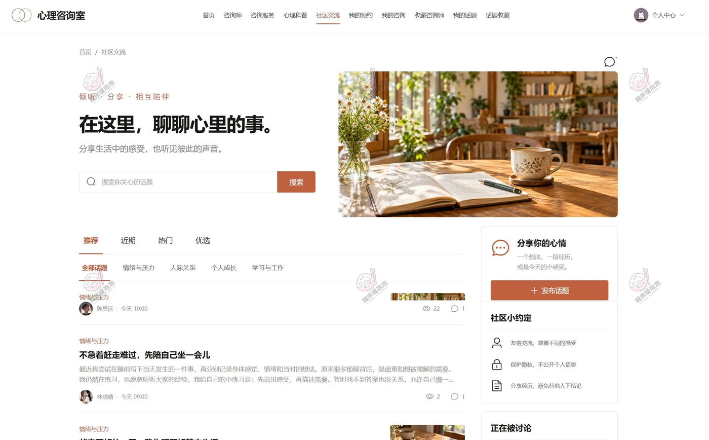

右侧是「分享你的心情」发布入口、三条「社区小约定」（友善交流、保护隐私、分享经历不替他人下结论）和「正在被讨论」榜单。

#### 社区话题详情

标题「把待办清单缩短以后，压力真的变小了」，作者陈思远，时间 2026.10.24 10:00，右上角显示 22 次浏览。正文分三段讲自己怎么把任务拆小、给休息留时间、练习跟同事说明工作边界，配一张插画。底部是「收藏话题 / 复制链接」和「说说你的想法」评论区。

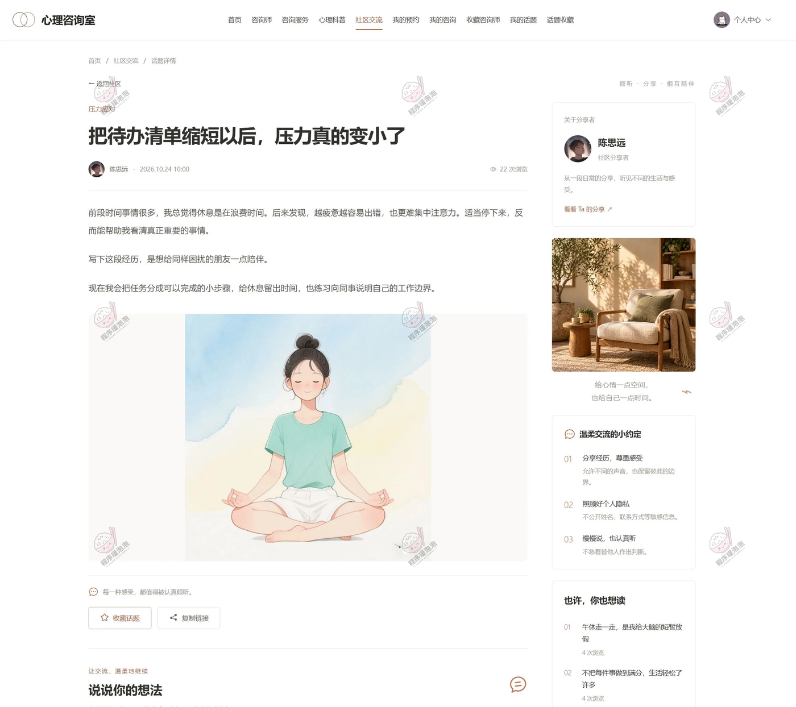

右侧栏依次是「关于分享者」（头像、身份、一句简介、查看 TA 的分享）、「温柔交流的小约定」三条、「也许你也想读」两篇推荐。同一篇话题在后台话题管理里显示 21 次浏览，前台详情页 22 次——差的那一次就是这次打开。

#### 收藏咨询师

页头写「我的收藏 4 位咨询师」，右上可切「按收藏时间排序」，搜索框可按姓名过滤。卡片横排：左侧照片，中间姓名、职称、擅长方向、联系电话，右上角红心「已收藏」，底部「查看详情 / 取消收藏 / 查看预约」。

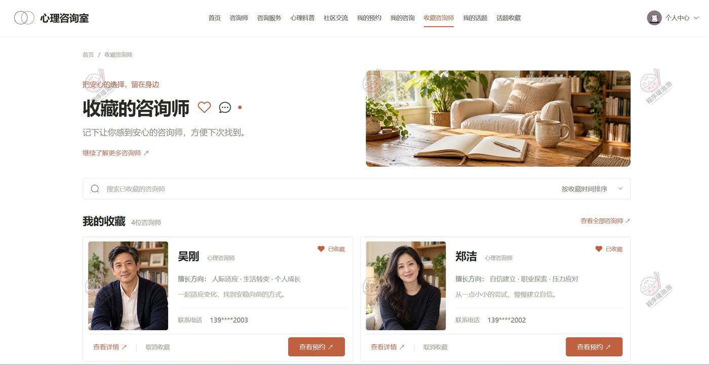

吴刚擅长人际适应、生活转变、个人成长，电话 139****2003；郑洁擅长自信建立、职业探索、压力应对，电话 139****2002。收藏是预约的前置动作——收藏过的咨询师在预约页会直接标「已收藏」。

#### 我的话题

三个状态标签：全部话题、已通过、待审核、未通过，右侧按发布时间排序，支持搜索标题。帖子卡带分类、标题、摘要、审核状态标签、发布时间与浏览评论数。

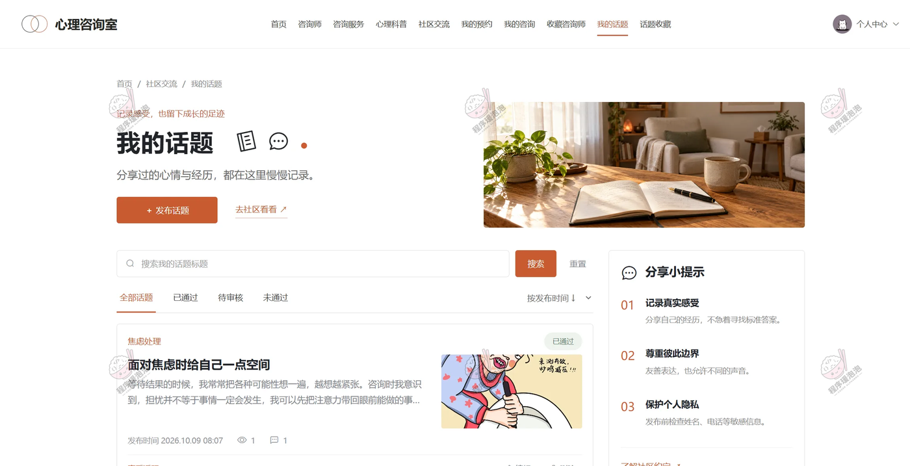

这条是「焦虑处理」分类下的《面对焦虑时给自己一点空间》，2026.10.09 08:07 发布，状态「已通过」，1 次浏览 1 条评论。右侧「分享小提示」提醒记录真实感受、尊重彼此边界、发布前检查姓名电话等敏感信息。

### 4.3 心理咨询师端

顶栏标「咨询师工作台」，左侧菜单四项：咨询师资料、排班管理、预约记录、我的咨询。

#### 排班管理

筛选按预约日期区间与预约时间区间查。表格列是心理咨询师姓名、预约日期、预约时间、数量（名额）、金额、操作。

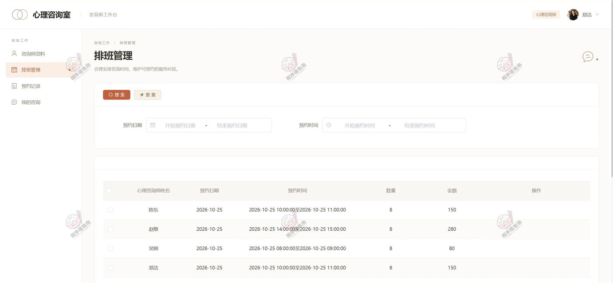

2026-10-25 这天排了四条：陈东 10:00–11:00 八个名额 150 元、赵敏 14:00–15:00 八个名额 280 元、吴刚 08:00–09:00 八个名额 80 元、郑洁 10:00–11:00 八个名额 150 元。用户端看到的「剩余 7 个名额」就是从这里 8 个名额扣掉已约 1 人。

#### 预约记录

筛选条件比排班多两项：预约编号、预约电话，另加预约时间区间。表格给预约编号、预约姓名、预约电话、咨询师姓名、预约时间，操作列是「进行接诊」与「取消」。

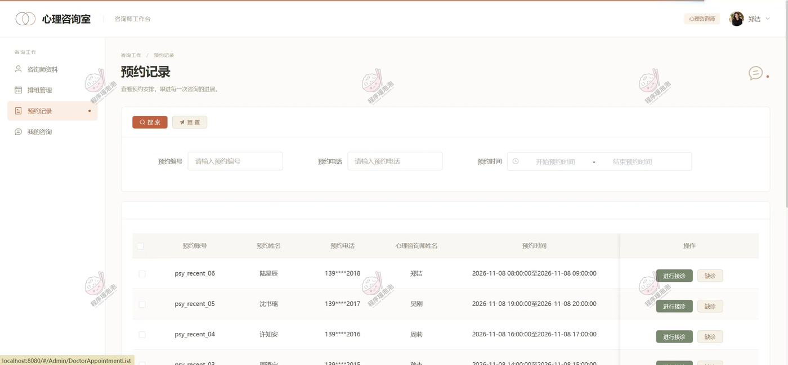

演示数据从 pay_recent_06 往前排：陆星辰（139****2018）约郑洁 2026-11-08 08:00–09:00；沈书瑶（139****2017）约吴刚 19:00–20:00；许知安约周莉 16:00–17:00。「进行接诊」就是把预约推到完成就诊这一步。

#### 我的咨询

左侧会话列表列出用户林知夏（最后一条消息预览），右侧对话区按时间戳排消息，左侧是用户气泡、右侧是自己发的（标注咨询师郑洁）。

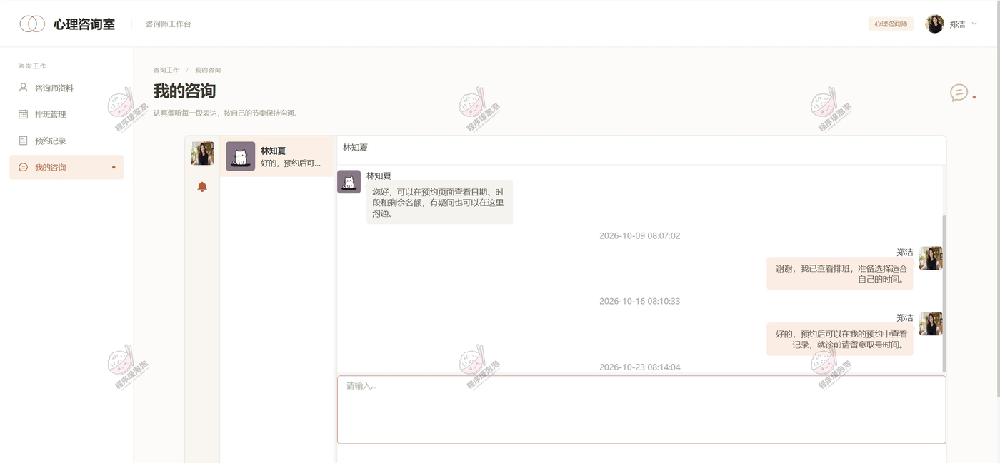

三条消息时间分别是 2026-10-09 08:07:02、2026-10-16 08:10:33、2026-10-23 08:14:04。这段对话和用户端「我的咨询」是同一段会话的两侧，WebSocket 推送，历史消息落库后可回查。

### 4.4 管理员端

顶栏标「管理工作台」，左侧菜单分四组：工作概览（数据看板、用户管理）、咨询服务（咨询师管理、排班管理、预约记录）、社区与科普（话题分类、话题管理、科普分类、科普文章）、数据分析（预约综合分析、未来预约预计、历史预约统计、咨询工作统计、话题统计、话题综合分析）。

#### 预约记录

管理员这页和咨询师端的预约记录是同一张列表（同一批 pay_recent_05 / 06 数据、同一个接口），差别在权限：管理员多了「心理咨询师」下拉与批量删除，行操作是「删除」而不是「进行接诊」。

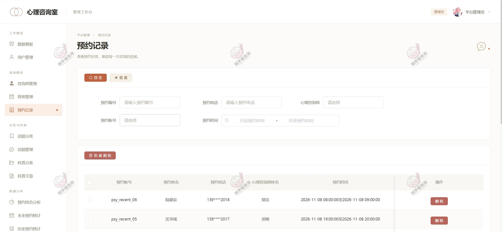

也就是说，接诊动作留在咨询师手里，管理员只做记录层面的维护与清理。

#### 话题管理

筛选按标题、话题类型查。表格列很多：标题、话题类型、封面、主图、浏览数、内容（内容浏览弹层）、是否推荐、审核状态、创建人、操作。

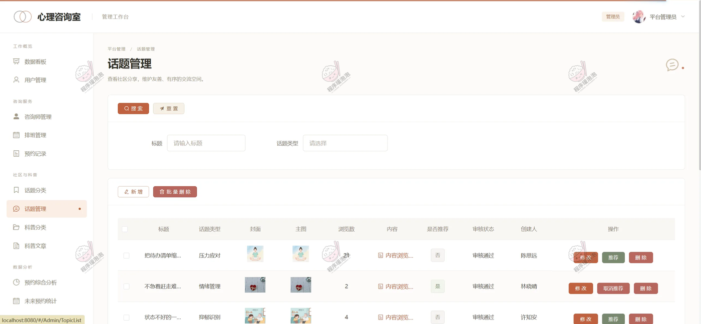

三条记录：《把待办清单缩…》压力应对 21 浏览、未推荐、审核通过、陈思远；《不急着赶走难…》情绪管理 2 浏览、已推荐、审核通过、林晓晴；《状态不好的…》抑郁识别 4 浏览、未推荐、审核通过、许知安。操作列按推荐状态给「推荐 / 取消推荐」，旁边是修改与删除——审核与推荐是两件独立的事。

#### 科普文章

表格列：标题、封面、内容、文章类型、是否置顶、阅读数、操作。三条记录阅读数 260、239、222，类型分别是沟通技巧、人际关系、压力应对，置顶一栏都是「否」。

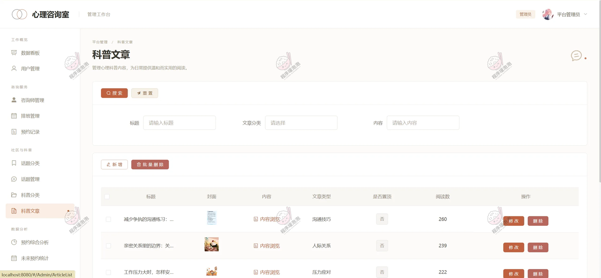

前台心理科普页那三张卡就是这批文章，阅读数比后台各多 1，正好是采集截图时打开详情页累加的那一次。

#### 预约综合分析

顶部四张数字卡：总预约数 453、已完成预约 210、用户取消率 7.00%、最高预约时段「上午」。下面三块图：预约状态分布（环形，图例含待就诊、完成、用户取消、心理咨询师取消、服务中、过期作废、取号完成）、时段分布（饼图，上午 186 次 41.06%、下午 179 次 39.51%、晚上 88 次 19.43%）、近 30 天预约趋势（折线，峰值 12）。

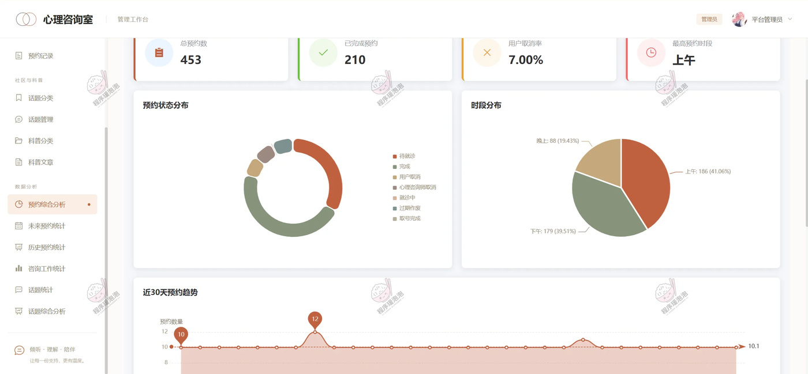

时段分布这三个数相加是 453，和总预约数对得上；三种时段里上午最多，和「最高预约时段：上午」的结论一致。

---

## 五、核心流程说明

**1. 选咨询师与预约**
用户从首页或咨询师列表进详情，看擅长方向与服务评价；决定后进咨询服务页，先按日期条选一天（未排班的日期不可选），再看当天各咨询师的剩余名额，点「选择时段」进入时段选择，最后确认预约信息。提交时系统检查是否重复预约、时段是否冲突，通过后扣减当天名额。

**2. 名额、取号与到访**
名额来自咨询师的排班配置（排班表里的「数量」列，演示数据是每时段 8 个）。预约成功后用户可在「我的预约」里线上取号，取号窗口在咨询前 2 小时内开放；到访超过预约时间 10 分钟未取号，预约自动失效。一个月内取消超过 3 次会被限制。

**3. 接诊与评价**
咨询师在预约记录里看到待就诊的预约，点「进行接诊」进入服务；用户在预约卡上看到状态变化，服务结束后可「查看/修改评价」，评分回流到咨询师详情页的评分统计。

**4. 过期作废（定时处理）**
Spring 定时任务扫预约表，把结束时间已过、状态还停在待就诊的记录标记为「过期作废」，预约状态分布图里能看到这一类。

**5. 在线沟通**
WebSocket 建立长连接，用户端「我的咨询」与咨询师端「我的咨询」是同一段会话的两侧，消息带时间戳入库，进页面即拉历史记录。预约前的疑问、时段的确认都在这里完成。

**6. 社区话题与审核**
用户发帖时选分类、传封面与主图，帖子先进入待审核；管理员在话题管理里审核通过后才在前台展示，还能置顶推荐。浏览数在每次打开详情时累加，评论、评论点赞、话题收藏分别落表，用户端「我的话题 / 话题收藏」按状态与时间回看自己的内容。

**7. 协同过滤话题推荐**
按用户的话题浏览记录构建兴趣向量，用余弦相似度找相近用户，把他们看过而当前用户没看过的帖子排进社区「推荐」标签；相近用户不足时退回近期热门。

**8. 数据看板与分析**
管理端从预约与话题两条线出图：预约侧看总数、完成数、取消率、时段分布与 30 天趋势；话题侧看浏览统计、分类分布、发布趋势与用户活跃度。咨询师维度另有服务人次与完成率，落到每个人的工作统计上。

---

## 六、说明
> 文档展示 18 张截图，需要了解更多，请联系我。
